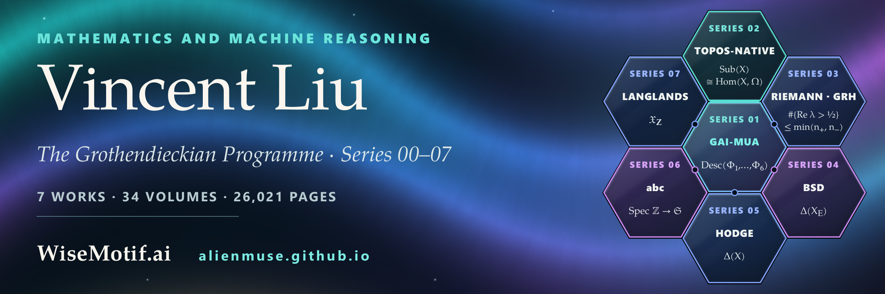

  

**Mathematics and machine reasoning.** I am the author of [*The Grothendieckian Programme*](https://github.com/AlienMuse/grothendieckian-programme), a programme for machine reasoning about mathematics, set out in seven works of the WiseMotif Monograph of Mathematical Intelligence (Series 01–07), with their overview (Series 00). [WiseMotif.ai](https://wisemotif.ai).

   

### The Grothendieckian Programme · Series 00–07

<table>
  <tr>
    <td align="center" valign="top" width="25%">
       
      SERIES 00 
      <a href="https://github.com/AlienMuse/grothendieckian-programme"><b><i>The Grothendieckian Programme</i></b></a> 
      the Programme&#x27;s overview 
      one book · 53 pages 
      <a href="https://doi.org/10.5281/zenodo.23669107">doi:10.5281/zenodo.23669107</a>
    </td>
    <td align="center" valign="top" width="25%">
       
      SERIES 01 
      <a href="https://github.com/AlienMuse/grothendieckian-machine"><b><i>GAI-MUA: The Grothendieckian Machine</i></b></a> 
      the core 
      6 volumes · 14,905 pages 
      <a href="https://doi.org/10.5281/zenodo.23480696">doi:10.5281/zenodo.23480696</a>
    </td>
    <td align="center" valign="top" width="25%">
       
      SERIES 02 
      <a href="https://github.com/AlienMuse/topos-native-intelligence"><b><i>GM-Omega-Infinity: Topos-Native Intelligence</i></b></a> 
      the meta-reasoning kernel 
      5 volumes · 4,020 pages 
      <a href="https://doi.org/10.5281/zenodo.23538544">doi:10.5281/zenodo.23538544</a>
    </td>
    <td align="center" valign="top" width="25%">
       
      SERIES 03 
      <a href="https://github.com/AlienMuse/arithmetic-spectral-descent"><b><i>Arithmetic Spectral Descent</i></b></a> 
      research subject 1 · RH and GRH 
      4 volumes · 1,549 pages 
      <a href="https://doi.org/10.5281/zenodo.23564898">doi:10.5281/zenodo.23564898</a>
    </td>
  </tr>
  <tr>
    <td align="center" valign="top" width="25%">
       
      SERIES 04 
      <a href="https://github.com/AlienMuse/fractured-adelic-geometry"><b><i>Fractured Adelic Geometry</i></b></a> 
      research subject 2 · BSD 
      4 volumes · 571 pages 
      <a href="https://doi.org/10.5281/zenodo.23585887">doi:10.5281/zenodo.23585887</a>
    </td>
    <td align="center" valign="top" width="25%">
       
      SERIES 05 
      <a href="https://github.com/AlienMuse/the-archimedean-prism"><b><i>The Archimedean Prism</i></b></a> 
      research subject 3 · Hodge 
      5 volumes · 1,309 pages 
      <a href="https://doi.org/10.5281/zenodo.23597954">doi:10.5281/zenodo.23597954</a>
    </td>
    <td align="center" valign="top" width="25%">
       
      SERIES 06 
      <a href="https://github.com/AlienMuse/strained-prismatic-geometry"><b><i>Strained Prismatic Geometry</i></b></a> 
      research subject 4 · abc 
      5 volumes · 1,666 pages 
      <a href="https://doi.org/10.5281/zenodo.23610034">doi:10.5281/zenodo.23610034</a>
    </td>
    <td align="center" valign="top" width="25%">
       
      SERIES 07 
      <a href="https://github.com/AlienMuse/the-arithmetic-topos"><b><i>The Arithmetic Topos</i></b></a> 
      research subject 5 · Langlands 
      5 volumes · 2,001 pages 
      <a href="https://doi.org/10.5281/zenodo.23629681">doi:10.5281/zenodo.23629681</a>
    </td>
  </tr>
</table>

7 works · 34 volumes · 26,021 pages · 995 chapters · 349,000+ formulas · 714 algorithms — each count taken by two independent methods from the sealed editions ([STATISTICS.md](https://github.com/AlienMuse/grothendieckian-programme/blob/main/STATISTICS.md)). Each work has its own repository, its own DOI and its own boundary in its own words; the overview, Series 00, adds no mathematical result to them.

### Approach

- **Worlds.** At its centre, The Grothendieckian Machine (Series 01) holds mathematical worlds as typed, versioned and verifiable objects, with the status of every claim part of its type.
- **Descent.** Over it, Topos-Native Intelligence (Series 02) reasons inside a world as inside a topos: a context is a site, the evidence a sheaf, a conclusion a global section that exists only where the local data glue, and a failure to glue an obstruction that can be located.
- **Recursive discovery.** Around them, five research subjects (Series 03–07) — the Riemann Hypothesis and its generalisation, the conjecture of Birch and Swinnerton-Dyer, the Hodge conjecture, the abc conjecture and the Langlands programme — carry the method of recursive mathematical discovery through in full: a structure is proposed, tested against the cases in which the answer is known and abstracted where it survives, and the question is posed again; what fails is kept, as an obstruction, a gap or a test.

**None of the seven works claims a proof of the problems it studies.** Each says what it proves, what it reduces to stated hypotheses, and where it stops.

### Contact

[ORCID 0009-0000-8718-222X](https://orcid.org/0009-0000-8718-222X) · [Google Scholar](https://scholar.google.com/citations?user=t0sMkU0AAAAJ) · [alienmuse.github.io](https://alienmuse.github.io/) ([中文](https://alienmuse.github.io/zh/)) · [Zenodo community](https://zenodo.org/communities/grothendieckian-programme) · [vincent.liu@wisemotif.ai](mailto:vincent.liu@wisemotif.ai)
